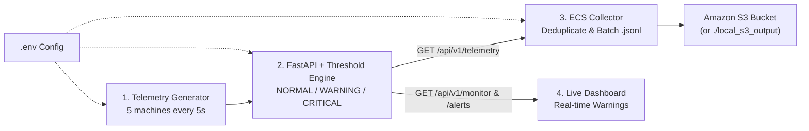
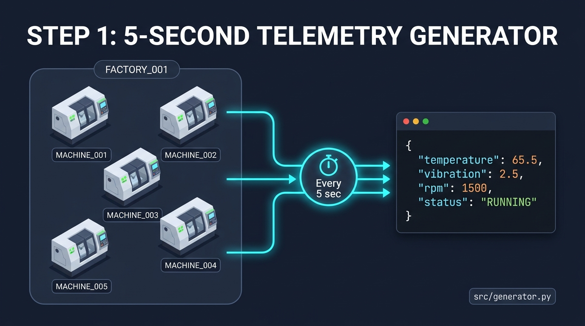
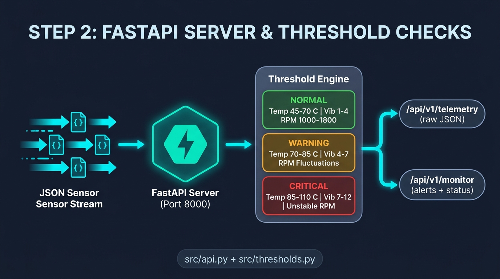
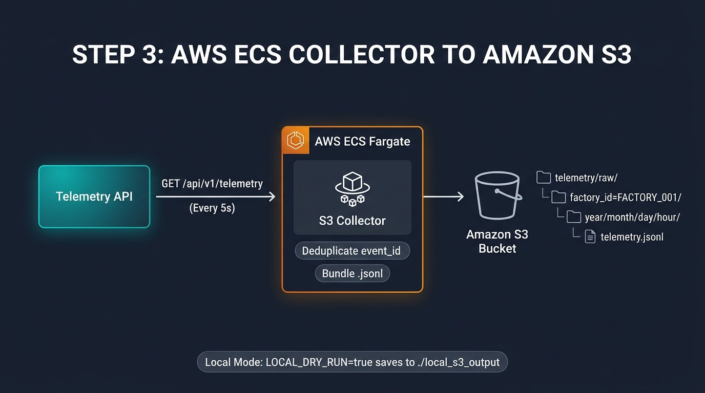
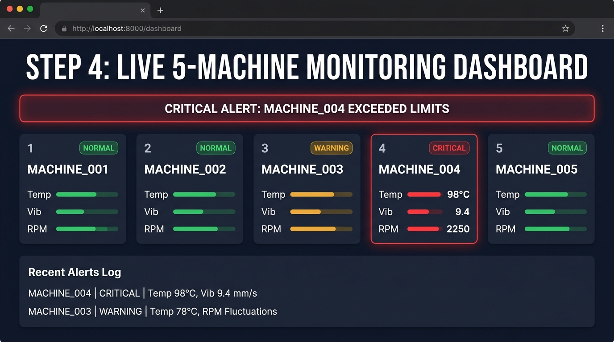

# IoT Factory Machine Monitoring System

An end-to-end IoT telemetry pipeline that generates real-time sensor readings every **5 seconds** for **5 industrial machines** (`MACHINE_001` – `MACHINE_005`), exposes them through a **FastAPI REST API**, collects and archives them into **Amazon S3 using AWS ECS Fargate**, and monitors all 5 machines in a **live warning/critical dashboard**.

> **Safe Local-First Setup:** No AWS resources are created automatically. By default (`LOCAL_DRY_RUN=true`), the collector writes partitioned `.jsonl` files locally to `./local_s3_output/`, while Dockerfiles and ECS Fargate task definitions are ready for AWS deployment whenever you need them.

---

## Architecture Overview



---

## How It Works (Step-by-Step with Pictures)

### Step 1: 5-Second Telemetry Generator (`src/generator.py`)



1. Every **5 seconds** (`GENERATION_INTERVAL_SECONDS=5`), `TelemetryGenerator.generate_batch()` generates a reading for all 5 configured machines (`MACHINE_001` through `MACHINE_005`) in `FACTORY_001`.
2. Each machine tracks its previous RPM and operating regime (`NORMAL`, `WARNING`, or `CRITICAL`) across ticks so temperature spikes, vibration increases, RPM fluctuations, and unstable RPM swings behave realistically.
3. Every event follows this exact JSON schema:

```json
{
  "event_id": "UUID",
  "machine_id": "MACHINE_001",
  "factory_id": "FACTORY_001",
  "timestamp": "2026-11-18T10:00:00Z",
  "temperature": 65.5,
  "vibration": 2.5,
  "rpm": 1500,
  "status": "RUNNING"
}
```

---

### Step 2: FastAPI Server & Threshold Engine (`src/api.py` + `src/thresholds.py`)



1. Starting FastAPI launches the Step 1 generator automatically in a background task and saves incoming readings in `TelemetryStore`.
2. Before storing each reading, `evaluate_telemetry()` checks **Temperature**, **Vibration**, **RPM**, and **tick-to-tick RPM change (`rpm_delta`)** against the alert limits:

| Status | Temperature | Vibration | RPM |
|---|---|---|---|
| **NORMAL** | `45–70 °C` | `1–4 mm/s` | `1000–1800` (stable, `\|Δ\| <= 150`) |
| **WARNING** | `70–85 °C` | `4–7 mm/s` | RPM fluctuations (`150 < \|Δ\| <= 350` or `800–1000` / `1800–2100`) |
| **CRITICAL** | `85–110 °C` | `7–12 mm/s` | Unstable RPM (`\|Δ\| > 350` or `< 800` / `> 2100`) |

3. FastAPI exposes two primary API views:
   - `GET /api/v1/telemetry` — **Raw 8-field JSON** for all 5 machines (consumed by the S3 collector).
   - `GET /api/v1/monitor` & `GET /api/v1/alerts` — **Threshold-evaluated status + active warnings** (consumed by the dashboard).

---

### Step 3: AWS ECS Collector → Amazon S3 (`src/collector.py` + `ecs/`)



1. A dedicated collector worker (`python -m src.collector`, packaged in `Dockerfile.collector` for **AWS ECS Fargate**) polls `GET /api/v1/telemetry` every **5 seconds**.
2. **Deduplication:** Each reading's `event_id` is checked against a rolling cache of seen UUIDs so duplicate readings are never written twice.
3. **JSONL Batching:** The 5 fresh readings are serialized into newline-delimited JSON (`.jsonl`), ready for AWS Athena, Glue, or Spark queries.
4. **Partitioned Storage:** Files are written using Hive/Athena-style time partitions:
   ```text
   s3://<S3_BUCKET_NAME>/telemetry/raw/factory_id=FACTORY_001/year=2026/month=11/day=18/hour=10/telemetry_20261118T100005Z_a1b2c3d4.jsonl
   ```
5. **Local Dry-Run vs. AWS ECS:**
   - When `LOCAL_DRY_RUN=true` in `.env`, the collector writes the exact same partitioned folder structure locally to `./local_s3_output/` without contacting AWS.
   - When `LOCAL_DRY_RUN=false` in AWS ECS, `boto3` uses the attached ECS Task IAM Role (`ecs/iam-s3-policy.json`) to upload directly to Amazon S3.

---

### Step 4: Live 5-Machine Monitoring Dashboard (`src/static/dashboard.html`)



1. Open `http://localhost:8000/dashboard` in your browser (served directly by FastAPI).
2. Every **5 seconds**, the dashboard fetches `/api/v1/monitor` and `/api/v1/alerts` and updates:
   - **Global Alert Banner:** Automatically lights up **amber** on `WARNING` or pulsing **red** on `CRITICAL`, identifying which machines and metrics exceeded their limits.
   - **5 Machine Cards (`MACHINE_001` – `MACHINE_005`):** Color-coded badges and progress bars for Temperature, Vibration, and RPM (+ RPM delta).
   - **Threshold Legend & Recent Alerts Log:** Quick reference for all limits plus a timestamped log of every warning and critical event.

---

## Project Structure

```text
iot_monitoring_system/
├── .env.example                       # Environment template (copy to .env)
├── .gitignore                         # Keeps .env and local dry-run outputs out of git
├── requirements.txt                   # Python dependencies
├── Dockerfile.api                     # Container image for Generator + FastAPI + Dashboard
├── Dockerfile.collector               # Container image for API -> S3 Collector
├── docker-compose.yml                 # Local 2-container stack (API + Collector)
├── docs/
│   └── images/                        # Step-by-step architecture & dashboard diagrams
│       ├── step1_generator.jpg
│       ├── step2_api_thresholds.jpg
│       ├── step3_ecs_s3.jpg
│       └── step4_dashboard.jpg
├── ecs/
│   ├── task-definition-api.json       # AWS ECS Fargate task definition (API)
│   ├── task-definition-collector.json # AWS ECS Fargate task definition (Collector)
│   └── iam-s3-policy.json             # Least-privilege S3 PutObject IAM policy
└── src/
    ├── __init__.py
    ├── config.py                      # Loads configuration from .env
    ├── models.py                      # Pydantic schemas (TelemetryEvent, AlertLevel)
    ├── thresholds.py                  # NORMAL / WARNING / CRITICAL rules & evaluator
    ├── generator.py                   # 5-machine, 5-second telemetry generator
    ├── api.py                         # FastAPI server + background generator + dashboard route
    ├── collector.py                   # ECS-ready API -> S3 collector (with local dry-run)
    └── static/
        └── dashboard.html             # Live 5-machine monitoring UI
```

---

## Quick Start (Run Locally — No AWS Required)

1. **Clone & configure environment**
   ```bash
   git clone https://github.com/surya241022/iot_monitoring_system.git
   cd iot_monitoring_system
   cp .env.example .env
   ```
   *(On Windows PowerShell: `Copy-Item .env.example .env`)*

2. **Install dependencies**
   ```bash
   pip install -r requirements.txt
   ```

3. **Start the Telemetry API + Dashboard (Terminal 1)**
   ```bash
   uvicorn src.api:app --host 0.0.0.0 --port 8000 --reload
   ```
   - Live Dashboard: `http://localhost:8000/dashboard`
   - Interactive Swagger Docs: `http://localhost:8000/docs`
   - Raw Telemetry JSON: `http://localhost:8000/api/v1/telemetry`

4. **Start the S3 Collector in Local Dry-Run Mode (Terminal 2)**
   ```bash
   python -m src.collector
   ```
   Partitioned `.jsonl` files will appear every 5 seconds inside `./local_s3_output/`.

5. **(Optional) Run with Docker Compose**
   ```bash
   docker compose up --build
   ```

---

## API Reference

| Endpoint | Description |
|---|---|
| `GET /dashboard` (or `/`) | Live 5-machine monitoring dashboard |
| `GET /health` | Health check and event generation stats |
| `GET /api/v1/telemetry` | Latest raw 8-field telemetry for all 5 machines |
| `GET /api/v1/telemetry/{machine_id}` | Latest raw telemetry for a specific machine (e.g., `MACHINE_001`) |
| `GET /api/v1/telemetry/history` | Historical raw events (`?machine_id=&limit=50`) |
| `GET /api/v1/monitor` | Latest readings enriched with `NORMAL`/`WARNING`/`CRITICAL` status |
| `GET /api/v1/alerts` | Recent `WARNING` and `CRITICAL` alerts (`?level=CRITICAL&limit=50`) |
| `GET /api/v1/thresholds` | Configured threshold definitions |

---

## Deploying to AWS ECS & S3 (When Ready)

1. Create an Amazon S3 bucket for raw telemetry storage.
2. Create an IAM Task Role (`telemetryCollectorS3Role`) with [ecs/iam-s3-policy.json](ecs/iam-s3-policy.json) attached (replace `<YOUR_S3_BUCKET_NAME>`).
3. Build and push `Dockerfile.api` and `Dockerfile.collector` to Amazon ECR.
4. Update the `<ACCOUNT_ID>`, `<AWS_REGION>`, `<YOUR_S3_BUCKET_NAME>`, and `<INTERNAL_ALB_OR_SERVICE_DISCOVERY_DNS>` placeholders in:
   - `ecs/task-definition-api.json`
   - `ecs/task-definition-collector.json` (`LOCAL_DRY_RUN` is already set to `false`)
5. Register both task definitions and launch them as services in your AWS ECS Fargate cluster.
